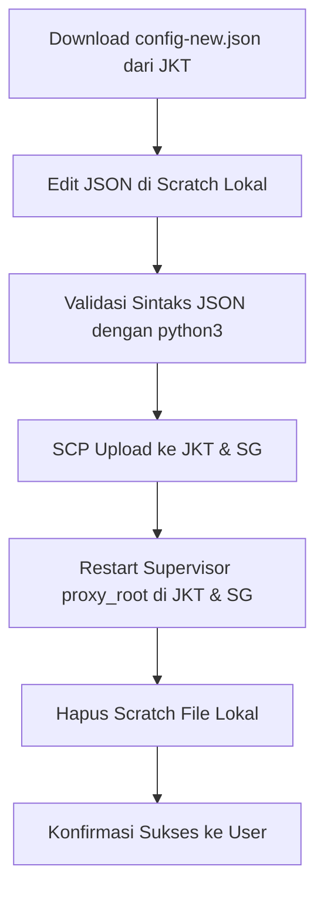

# 🌐 TOKOBUAH PLATFORM — GAME PROVIDER PROXY & STREAMING PIPELINE OPERATIONS RUNBOOK
> **File Name**: `PROVIDER_PROXY_AND_STREAMING_OPERATIONS.md`  
> **Document Version**: 1.0.0  
> **Created Date**: 2026-11-15  
> **Workspace Path**: `/Users/avocado/tokobuah/infra-stuff/`  
> **Primary Maintainers**: DevOps, SRE, and AI Autonomous Agents  
> **Precedence & Governance**: Strictly governed by Global Safety Rules in `~/AGENTS.md` and `MASTER_INFRA_KNOWLEDGE_BASE.md`. Stricter rule wins.

---

## 📑 TABLE OF CONTENTS
1. [Ringkasan Eksekutif & Tujuan Sesi](#1-ringkasan-eksekutif--tujuan-sesi)
2. [Topologi & Komponen Terkait](#2-topologi--komponen-terkait)
   - [2.1 Multi-Region Reverse Proxy Fleet (Jakarta & Singapore)](#21-multi-region-reverse-proxy-fleet-jakarta--singapore)
   - [2.2 Confluent Cloud Kafka Streaming Layer](#22-confluent-cloud-kafka-streaming-layer)
   - [2.3 Google BigQuery Analytical Data Warehouse](#23-google-bigquery-analytical-data-warehouse)
   - [2.4 Database & Internal Routing Dependencies](#24-database--internal-routing-dependencies)
3. [Catatan Perubahan & Perintah yang Telah Dijalankan](#3-catatan-perubahan--perintah-yang-telah-dijalankan)
   - [3.1 Kronologi Infrastruktur Reverse Proxy](#31-kronologi-infrastruktur-reverse-proxy)
   - [3.2 Konsolidasi & Optimalisasi Kafka Staging Connector](#32-konsolidasi--optimalisasi-kafka-staging-connector)
   - [3.3 Audit & Investigasi SMT Production Kafka-to-BigQuery](#33-audit--investigasi-smt-production-kafka-to-bigquery)
   - [3.4 Onboarding Client Baru: Hambabet](#34-onboarding-client-baru-hambabet)
   - [3.5 Inventaris Lengkap Rute Provider yang Telah Ditambahkan](#35-inventaris-lengkap-rute-provider-yang-telah-ditambahkan)
4. [Caveat, Gotchas, & Error yang Sempat Terjadi](#4-caveat-gotchas--error-yang-sempat-terjadi)
   - [4.1 Confluent Cloud Managed Connector SMT & Duplicate Table Restriction](#41-confluent-cloud-managed-connector-smt--duplicate-table-restriction)
   - [4.2 Dead Letter Queue (DLQ) & Schema Mismatches](#42-dead-letter-queue-dlq--schema-mismatches)
   - [4.3 Supervisor Process Grouping & Port 80 Zombie Bindings](#43-supervisor-process-grouping--port-80-zombie-bindings)
   - [4.4 Trailing Slash Normalization pada Reverse Proxy](#44-trailing-slash-normalization-pada-reverse-proxy)
   - [4.5 Dual-Server Out-of-Sync Risk (Split-Brain)](#45-dual-server-out-of-sync-risk-split-brain)
5. [Standard Operating Procedure (SOP) & Runbook](#5-standard-operating-procedure-sop--runbook)
   - [5.1 SOP Menambah / Mengubah Route Provider Proxy](#51-sop-menambah--mengubah-route-provider-proxy)
   - [5.2 SOP Onboarding Client Baru pada Kafka & BigQuery](#52-sop-onboarding-client-baru-pada-kafka--bigquery)
   - [5.3 Verification, Health-Check, & Troubleshooting Commands](#53-verification-health-check--troubleshooting-commands)
6. [Guardrails & Batasan Keamanan Khusus](#6-guardrails--batasan-keamanan-khusus)

---

## 1. RINGKASAN EKSEKUTIF & TUJUAN SESI

Dokumentasi ini merangkum seluruh evolusi, keputusan arsitektur, dan instruksi operasional harian yang dibangun sepanjang sesi kerja platform **Tokobuah**. Terdapat dua pilar infrastruktur utama yang dikelola secara intensif:

1. **Multi-Region Reverse Proxy Fleet (Jakarta & Singapore)**:
   * **Masalah**: Integrasi dengan 40+ vendor/provider game pihak ketiga (seperti Pragmatic Play, PG Soft, Evolution, Spribe, Habanero, Jili, Hacksaw, Microgaming, dsb.) memerlukan static egress IP terpercaya, isolasi network, fleksibilitas path mapping antara staging dan production, serta ketersediaan tinggi lintas region (ID & SG).
   * **Solusi**: Diterapkannya 2 VM mirror berlatensi rendah (`proxy-stg-jkt` di Jakarta dan `proxy-stg-sg` di Singapura) yang menjalankan custom Go Reverse Proxy daemon (`proxy_root`) di bawah kendali `supervisord`, dengan konfigurasi tersentralisasi di `/home/adminbuah/config-new.json`.
2. **Confluent Cloud Kafka to Google BigQuery Data Streaming Pipeline**:
   * **Masalah**: Redundansi connector di staging memicu pemborosan biaya cloud ($/connector-hour) dan lag pesan. Di sisi production, arsitektur multi-tenant memerlukan isolasi topic transaksi per client (`game-transaction-{tenant}`) namun tetap membutuhkan query analitik terpusat di BigQuery tanpa membebani tim data atau dashboard Superadmin.
   * **Solusi & Keputusan Utama**:
     * Di **Staging**: Berhasil mengonsolidasikan dua connector (`lcc-k8g202g` dan `lcc-pgkvzj5`) menjadi 1 connector tunggal tanpa lag dan mengeliminasi pesan DLQ.
     * Di **Production**: Mengevaluasi opsi penyatuan tabel menggunakan Confluent SMT (`RegexRouter`). Karena Confluent Cloud secara ketat memblokir mapping duplikat ke tabel tujuan yang sama (`Table names cannot be duplicated`) serta membatasi custom SMT, diambil keputusan arsitektural yang aman: mempertahankan mapping 1-to-1 (`game-transaction-{tenant}` ➡️ `game_transaction_{tenant}_raw`) dan memanfaatkan fitur **BigQuery Wildcard Union View** (`view_all_game_transactions_raw`). Pola ini menjamin **zero code change** pada dashboard saat onboarding client baru.
     * Memformalkan **Playbook Onboarding Client Baru** (diuji langsung pada client `hambabet`).

---

## 2. TOPOLOGI & KOMPONEN TERKAIT

### 2.1 Multi-Region Reverse Proxy Fleet (Jakarta & Singapore)

```
                             [ User / Game Clients / Frontend ]
                                            │
                    ┌───────────────────────┴───────────────────────┐
                    ▼                                               ▼
       [ Jakarta Proxy Server ]                        [ Singapore Proxy Server ]
       • Host: proxy-stg-jkt                           • Host: proxy-stg-sg
       • External IP: 34.101.110.121                   • External IP: 34.21.136.141
       • Listen: Port 80 (HTTP)                        • Listen: Port 80 (HTTP)
       • Daemon: supervisord (proxy_root)              • Daemon: supervisord (proxy_root)
       • Binary: /home/adminbuah/proxy                 • Binary: /home/adminbuah/proxy
       • Config: /home/adminbuah/config-new.json       • Config: /home/adminbuah/config-new.json
                    │                                               │
                    └───────────────────────┬───────────────────────┘
                                            │ Reverse Proxy Forwarding
                                            ▼
           [ 70+ External 3rd Party Game Provider APIs & Staging/Prod Endpoints ]
           (Pragmatic Play, PG Soft, Evolution, Spribe, Habanero, Jili, Hacksaw, etc.)
```

* **Server 1: Jakarta (`proxy-stg-jkt`)**:
  * **Public Static IP**: `34.101.110.121`
  * **OS / User**: Linux Ubuntu / `adminbuah`
  * **Auth**: SSH Key (`/Users/avocado/.ssh/id_rsa`), passwordless sudoers
  * **Firewall Tag**: Khusus mengizinkan port 80 HTTP traffic masuk tanpa membuka VM lain di VPC.
* **Server 2: Singapore (`proxy-stg-sg`)**:
  * **Public Static IP**: `34.21.136.141`
  * **OS / User**: Linux Ubuntu / `adminbuah`
  * **Auth**: SSH Key (`/Users/avocado/.ssh/id_rsa`), passwordless sudoers
* **Supervisor Configuration (`/etc/supervisor/conf.d/` atau `/etc/supervisord.conf`)**:
  ```ini
  [program:proxy_root]
  directory=/home/adminbuah
  command=/bin/bash -c "/home/adminbuah/proxy start --config /home/adminbuah/config-new.json | sed -u -E 's/\x1b\[[0-9;]*m//g'"
  user=root
  autostart=true
  autorestart=true
  stopasgroup=true
  killasgroup=true
  redirect_stderr=true
  stdout_logfile=/var/log/proxy.out.log
  ```

---

### 2.2 Confluent Cloud Kafka Streaming Layer

* **Biaya & Tipe Cluster (audit billing API 2026-11-24)**: prod `lkc-38r9y82` **STANDARD / high availability / ~2 eCKU** ≈ **$1.313/bln**; staging `lkc-2227jno` **BASIC / low / 1 eCKU** ≈ **$118/bln**; 2× BigQuery connector (task $0.125/jam) ≈ **$182/bln**; network+storage ≈ $25/bln. **Run-rate total ≈ $1.641/bln (~$19.7k/tahun)**. Kedua cluster bertipe elastic (eCKU) — tidak bisa "resize manual"; 2 eCKU prod = floor SLA 99.99% (high avail). Lever: pause connector staging (≈$91/bln, reversible); turunkan prod ke 1 eCKU = migrasi ke STANDARD 99.9% single-zone (recreate, bukan resize).

* **Production Environment**: `env-5d9zj2`
* **Production Kafka Cluster**: `lkc-38r9y82`
* **Staging Environment**: `env-zw1k1z` *(dikoreksi 2026-11-24 — live; sebelumnya tercatat `env-q11880` = env lama)*
* **Staging Kafka Cluster**: `lkc-2227jno` (`tokobuah-development`)
* **Service Account / Admin API**:
  * SA ID: `sa-63v669j` (`ai-assistant`)
  * API Key: `PI2TJVYG********` *(masked)*
  * API Secret: `cflta/cO51Sm********` *(masked)*
* **BigQuery Sink Connectors**:
  * **Production Connector ID**: `lcc-nvy9oqz` (`BigQueryStorageSinkConnector`)
  * **Staging Connector ID (Active)**: `lcc-k8g202g` (`BigQueryStorageSinkConnector_0`)
  * **Staging Connector ID (Deleted/Merged)**: `lcc-pgkvzj5` (`BigQueryStorageSinkConnector_1`)
* **Kafka Topics Mapping**:
  * `game-transaction-{clientCode}`: Dedicated topic per client/tenant (e.g. `buah5758`, `ikn788`, `hambabet`, `ikndev`).
    * Partition: 4
    * Cleanup Policy: `delete`
  * Shared Business Event Topics: `audit.event`, `ticket.granted`, `spinwheel.prize.won`.

---

### 2.3 Google BigQuery Analytical Data Warehouse

* **Target GCP Project**: `tokobuah-production` (dan `tokobuah-staging` untuk staging)
* **Dataset**: `game_reports`
* **Raw Table Pattern**: `game_transaction_{clientCode}_raw`
  * **Partitioning**: Daily on `processedAt` (`TIMESTAMP`)
  * **Schema Definition**:
    ```
    transactionId:STRING, memberId:STRING, walletId:STRING, operatorId:STRING,
    operatorCode:STRING, providerId:STRING, gameId:STRING, providerRoundId:STRING,
    providerTxnId:STRING, memberUuid:STRING, gameCode:STRING, categoryCode:STRING,
    agentCode:STRING, agentLvl:INTEGER, brandCode:STRING, type:STRING,
    amount:NUMERIC, balanceBefore:NUMERIC, balanceAfter:NUMERIC,
    orderNumber:INTEGER, currency:STRING, processedAt:TIMESTAMP
    ```
* **Unified Wildcard View**: `view_all_game_transactions_raw`
  * Query dasar:
    ```sql
    SELECT * FROM `tokobuah-production.game_reports.game_transaction_*`
    ```
  * Berfungsi sebagai single-entrypoint bagi seluruh analytical views (`view_agent_dashboard`, reporting queries, and Superadmin Dashboard).

---

### 2.4 Database & Internal Routing Dependencies

* **Production DB Proxy VM**: `prod-db-proxy`
  * Berfungsi sebagai HAProxy internal layer untuk merutekan koneksi aplikasi ke Cloud SQL PostgreSQL per tenant (`buah5758`, `ikn788`, `hambabet`, etc.).
  * Terproteksi dalam internal VPC; kredensial database diakses melalui Secret Manager atau secure environment variables.

---

## 3. CATATAN PERUBAHAN & PERINTAH YANG TELAH DIJALANKAN

### 3.1 Kronologi Infrastruktur Reverse Proxy
1. **Provisioning VM `proxy-stg-jkt`**:
   * Dibuat menggunakan Google Compute Engine, static external IP direservasi (`34.101.110.121`).
   * Instalasi `supervisord`, pengaturan firewall VPC agar port 80 hanya terbuka khusus pada VM ini.
2. **Provisioning VM Mirror `proxy-stg-sg`**:
   * Dibuat identik di region Singapura (`34.21.136.141`), static IP direservasi.
   * Binary `go-reverse-proxy` dikompilasi dan ditempatkan di `/home/adminbuah/proxy`.
3. **Konfigurasi Supervisor & Log Sanitization**:
   * Menambahkan filter `sed` pada supervisor command untuk membersihkan ANSI color escape codes dari log output Go binary ke `/var/log/proxy.out.log`.
   * Menambahkan parameter `stopasgroup=true` dan `killasgroup=true` untuk mencegah orphan process saat restart.

---

### 3.2 Konsolidasi & Optimalisasi Kafka Staging Connector
* **Status Awal**: Staging memiliki 2 sink connector terpisah (`lcc-k8g202g` dan `lcc-pgkvzj5`), memicu tagihan ganda dan terjadi penumpukan 1000+ pesan di DLQ topic.
* **Akar Masalah DLQ**: Transformasi SMT `ReplaceField$Value` mengecualikan field `username` dan `full_name` yang menyebabkan inkonsistensi skema.
* **Tindakan**:
  1. Memperbarui config `lcc-k8g202g` untuk mengonsumsi topic `game-transaction-ikndev` dan memetakan langsung ke `game_transactions_raw`.
  2. Menghapus `username,full_name` dari exclusion list agar skema payload sesuai.
  3. Menghapus connector duplikat `lcc-pgkvzj5`.
  4. Verifikasi lag mencapai **0** dan pesan terserap sempurna ke BigQuery.

---

### 3.3 Audit & Investigasi SMT Production Kafka-to-BigQuery
* **Eksperimen**: User mengusulkan konsolidasi tabel di BigQuery production agar seluruh topic transaksi masuk ke satu tabel tunggal `game_transactions_raw`.
* **Uji Coba & Blocker**:
  * Saat menambahkan duplikat target pada `topic2table.map`, Confluent Cloud menolak update:
    > `The table name game_transactions_raw is duplicated. Table names cannot be duplicated.`
  * Saat mencoba menggunakan SMT `RegexRouter` (`org.apache.kafka.connect.transforms.RegexRouter`), policy organisasi Confluent Cloud menolak penambahan custom transform class.
* **Protokol Rollback Aman**:
  * Seluruh modifikasi dibatalkan dengan aman (restore table mappings, restore BQ views, dan membatalkan penghapusan tabel split).
  * Arsitektur tetap dipertahankan pada isolasi tabel split dengan agregasi **Wildcard Table View** BigQuery, tanpa kehilangan data historis (160M+ baris transaksi aman).

---

### 3.4 Onboarding Client Baru: Hambabet
Untuk client baru `hambabet`, langkah terverifikasi yang dijalankan meliputi:
1. **Pembuatan Topic Kafka**:
   ```bash
   confluent kafka topic create game-transaction-hambabet \
     --partitions 4 \
     --environment env-5d9zj2 \
     --cluster lkc-38r9y82
   ```
2. **Pembuatan Raw Partitioned Table di BigQuery**:
   ```bash
   bq mk --table \
     --time_partitioning_field processedAt \
     --time_partitioning_type DAY \
     --schema=transactionId:STRING,memberId:STRING,walletId:STRING,operatorId:STRING,operatorCode:STRING,providerId:STRING,gameId:STRING,providerRoundId:STRING,providerTxnId:STRING,memberUuid:STRING,gameCode:STRING,categoryCode:STRING,agentCode:STRING,agentLvl:INTEGER,brandCode:STRING,type:STRING,amount:NUMERIC,balanceBefore:NUMERIC,balanceAfter:NUMERIC,orderNumber:INTEGER,currency:STRING,processedAt:TIMESTAMP \
     tokobuah-production:game_reports.game_transaction_hambabet_raw
   ```
3. **Update Confluent Sink Connector**:
   Menambahkan `game-transaction-hambabet` ke parameter `topics` dan mapping `game-transaction-hambabet:game_transaction_hambabet_raw` ke `topic2table.map` pada connector `lcc-nvy9oqz`.

---

### 3.5 Inventaris Lengkap Rute Provider yang Telah Ditambahkan

Hingga saat ini, `/home/adminbuah/config-new.json` mengelola **72 rute reverse proxy** aktif pada kedua server. Berikut adalah rincian rute-rute penting yang telah ditambahkan dan divalidasi:

| Path Prefix (`proxy_path`) | Upstream Endpoint (`proxy_pass`) | Lingkungan |
| :--- | :--- | :---: |
| `/pg-dev` | `https://api.pg-bo.me` | Dev / Staging |
| `/pg-prod` | `https://api.pg-bo.net` | Production |
| `/evo-casino-dev` | `https://staging-api.asia-live.com` | Dev / Staging |
| `/cq9-prod` | `https://apii.cqgame.cc` | Production |
| `/cosmoplay-prod` | `https://intapi.cosmoplay.org` | Production |
| `/funky-prod` | `https://cfbb7e4b9e25.funplayfky.com` | Production |
| `/habanero-prod` | `https://ws-a.insvr.com` | Production |
| `/jili-prod1` s/d `prod11` | `https://wb-api-2.huuykk865s.com`, `nqaqwty9.com`, `jiscc77s.com`, `k6749ktm.com`, `jiscc88.com`, `zcchb1ap.com`, `kijl788du.com`, `jismk2u.com`, `qu5feb8n.com`, `richjourney888.com`, `royalflush888.com` | Production |
| `/dragoonsoft-dev` | `https://api.sandsys.pw` | Dev / Staging |
| `/nagagames-dev` | `https://api.stg.game.topplatform.asia` | Dev / Staging |
| `/ggsoft-dev` | `https://3nnt3311.com` | Dev / Staging |
| `/microgaming-prod` | `https://api-superswansw.k2net.io` | Production |
| `/microgaming-sts-prod` | `https://sts-superswansw.k2net.io` | Production |
| `/afb-prod` | `https://api.afbgaming.net` | Production |
| `/hacksaw-dev` | `https://gaming.stagedc.net` | Dev / Staging |
| `/hacksaw-detail-dev` | `https://ticket.stagedc.net` | Dev / Staging |
| `/wmcasino-dev` | `https://api.wmetg.com` | Dev / Staging |
| `/tcg-prod` | `http://www.connect8play.com` | Production |
| `/pp-prod` *(Updated)* | `https://api-spe-17.api-spe.net` | Production |
| `/spribe-launch-dev` | `https://dev-test.spribe.io/games/launch` | Dev / Staging |
| `/spribe-game-detail-dev`| `https://games-info.staging.spribe.dev` | Dev / Staging |
| `/spribe-dev` | `https://secure-ga.staging.spribe.io/v3` | Dev / Staging |
| `/fruit4d-dev` | `http://10.10.31.221` | Dev / Staging |

---

## 4. CAVEAT, GOTCHAS, & ERROR YANG SEMPAT TERJADI

### 4.1 Confluent Cloud Managed Connector SMT & Duplicate Table Restriction
* **Gotcha**: Di self-managed Kafka Connect, pengguna bisa memasang plugin SMT kustom untuk merewrite topic target menjadi satu nama tabel. Namun, pada **Confluent Cloud Fully Managed Connector**:
  1. `topic2table.map` secara eksplisit melempar validasi error jika terdapat nama tabel target yang identik.
  2. Library `org.apache.kafka.connect.transforms.RegexRouter` tidak disediakan secara default.
* **Mitigasi Permanen**: Jangan pernah mencoba menyatukan nama tabel di level connector `topic2table.map`. Selalu gunakan arsitektur 1 topic : 1 table raw, dan serahkan penggabungan data ke BigQuery Wildcard Union (`game_transaction_*`).

### 4.2 Dead Letter Queue (DLQ) & Schema Mismatches
* **Gotcha**: Penggunaan `ReplaceField$Value` dengan parameter `blacklist` (atau `exclude`) pada topic event (seperti `audit.event`) yang menyaring field kritis menyebabkan deserializer BigQuery gagal menulis record.
* **Mitigasi**: Pastikan payload JSON yang masuk ke Kafka memiliki skema yang setara dengan tabel tujuan. Jika field tertentu tidak lagi digunakan, buat kolom tersebut bersifat `NULLABLE` di BigQuery alih-alih menyaringnya secara agresif di Kafka Connector.

### 4.3 Supervisor Process Grouping & Port 80 Zombie Bindings
* **Gotcha**: Supervisor mengawasi proses wrapper bash (`/bin/bash -c "proxy start ... | sed ..."`). Jika konfigurasi supervisor tidak memiliki:
  ```ini
  stopasgroup=true
  killasgroup=true
  ```
  maka saat menjalankan `supervisorctl restart`, proses bash induk mati tetapi binary child `proxy` tetap hidup di background memegang port 80. Akibatnya proses baru crash dengan error: `bind: address already in use`.
* **Mitigasi**: Opsi `stopasgroup=true` dan `killasgroup=true` wajib terpasang di kedua VM proxy.

### 4.4 Trailing Slash Normalization pada Reverse Proxy
* **Gotcha**: Ketika user memberikan input seperti:
  `/hacksaw-detail-dev https://ticket.stagedc.net/`
  atau
  `/spribe-game-detail-dev https://games-info.staging.spribe.dev/`
  Pemberian trailing slash pada upstream base URL (`proxy_pass`) dapat menghasilkan request forwarding ganda seperti `https://ticket.stagedc.net//path/v1`.
* **Mitigasi**: Selalu hilangkan trailing slash pada `proxy_pass` kecuali jika path tersebut memang mengarah ke subpath spesifik (contoh: `/v3` atau `/games/launch`).

### 4.5 Dual-Server Out-of-Sync Risk (Split-Brain)
* **Gotcha**: Karena Jakarta (`34.101.110.121`) dan Singapore (`34.21.136.141`) adalah dua VM independen, mengedit satu server saja akan menyebabkan traffic ke region lain me-return `404 Not Found`.
* **Mitigasi**: Setiap workflow penambahan rute **WAJIB** mengeksekusi SCP dan restart supervisor ke **KEDUA SERVER** secara berurutan dalam satu siklus kerja.

---

## 5. STANDARD OPERATING PROCEDURE (SOP) & RUNBOOK

### 5.1 SOP Menambah / Mengubah Route Provider Proxy

Setiap kali ada instruksi menambahkan route provider baru (misal: `/vendor-prod https://api.vendor.com`), ikuti urutan langkah berikut:



#### Langkah Operasional (Command Shell):
```bash
# 1. Download konfigurasi terbaru dari Jakarta Proxy
scp -i /Users/avocado/.ssh/id_rsa -o StrictHostKeyChecking=no \
  adminbuah@34.101.110.121:/home/adminbuah/config-new.json \
  /Users/avocado/.gemini/antigravity/scratch/config-new.json

# 2. Edit file lokal untuk menambahkan objek rute baru di array "proxies"
# Format:
# {
#     "proxy_pass": "https://api.vendor.com",
#     "proxy_path": "/vendor-prod"
# }

# 3. Validasi keabsahan sintaks JSON lokal
python3 -m json.tool /Users/avocado/.gemini/antigravity/scratch/config-new.json > /dev/null

# 4. Upload ke kedua proxy server (Jakarta dan Singapore)
scp -i /Users/avocado/.ssh/id_rsa -o StrictHostKeyChecking=no \
  /Users/avocado/.gemini/antigravity/scratch/config-new.json \
  adminbuah@34.101.110.121:/home/adminbuah/config-new.json

scp -i /Users/avocado/.ssh/id_rsa -o StrictHostKeyChecking=no \
  /Users/avocado/.gemini/antigravity/scratch/config-new.json \
  adminbuah@34.21.136.141:/home/adminbuah/config-new.json

# 5. Restart service proxy_root di kedua server
ssh -i /Users/avocado/.ssh/id_rsa -o StrictHostKeyChecking=no \
  adminbuah@34.101.110.121 "sudo supervisorctl restart proxy_root"

ssh -i /Users/avocado/.ssh/id_rsa -o StrictHostKeyChecking=no \
  adminbuah@34.21.136.141 "sudo supervisorctl restart proxy_root"

# 6. Bersihkan file konfigurasi sementara di lokal
rm /Users/avocado/.gemini/antigravity/scratch/config-new.json
```

---

### 5.2 SOP Onboarding Client Baru pada Kafka & BigQuery

Jika ada company code / client baru (contoh: `xyz99`), jalankan 3 tahapan wajib berikut:

#### Tahap 1: Buat Kafka Topic di Confluent Cloud
```bash
confluent kafka topic create game-transaction-xyz99 \
  --partitions 4 \
  --environment env-5d9zj2 \
  --cluster lkc-38r9y82
```

#### Tahap 2: Buat Raw Table di BigQuery (GCP Project: `tokobuah-production`)
```bash
bq mk --table \
  --time_partitioning_field processedAt \
  --time_partitioning_type DAY \
  --schema=transactionId:STRING,memberId:STRING,walletId:STRING,operatorId:STRING,operatorCode:STRING,providerId:STRING,gameId:STRING,providerRoundId:STRING,providerTxnId:STRING,memberUuid:STRING,gameCode:STRING,categoryCode:STRING,agentCode:STRING,agentLvl:INTEGER,brandCode:STRING,type:STRING,amount:NUMERIC,balanceBefore:NUMERIC,balanceAfter:NUMERIC,orderNumber:INTEGER,currency:STRING,processedAt:TIMESTAMP \
  tokobuah-production:game_reports.game_transaction_xyz99_raw
```

#### Tahap 3: Update Confluent BigQuery Sink Connector
Ambil config connector saat ini, tambahkan topic dan table map di akhir string:
```bash
confluent connect cluster update lcc-nvy9oqz \
  --environment env-5d9zj2 \
  --cluster lkc-38r9y82 \
  --config 'topics=audit.event,game-transaction-buah5758,ticket.granted,spinwheel.prize.won,game-transaction-ikn788,game-transaction-hambabet,game-transaction-xyz99' \
  --config 'topic2table.map=game-transaction-buah5758:game_transaction_buah5758_raw,audit.event:audit_raw,ticket.granted:tickets_raw,spinwheel.prize.won:prizes_raw,game-transaction-ikn788:game_transaction_ikn788_raw,game-transaction-hambabet:game_transaction_hambabet_raw,game-transaction-xyz99:game_transaction_xyz99_raw'
```

> **Catatan Penting**: BigQuery View `view_all_game_transactions_raw` menggunakan wildcard matcher `game_transaction_*`, sehingga data transaksi client baru akan langsung muncul otomatis pada dashboard tanpa perlu modifikasi query view atau backend!

---

### 5.3 Verification, Health-Check, & Troubleshooting Commands

#### 1. Verifikasi Status Proxy & Log Service:
```bash
# Cek status proses supervisor di Jakarta
ssh -i /Users/avocado/.ssh/id_rsa -o StrictHostKeyChecking=no adminbuah@34.101.110.121 "sudo supervisorctl status proxy_root"

# Cek 30 baris log terakhir proxy
ssh -i /Users/avocado/.ssh/id_rsa -o StrictHostKeyChecking=no adminbuah@34.101.110.121 "tail -n 30 /var/log/proxy.out.log"

# Test request lokal ke port 80
ssh -i /Users/avocado/.ssh/id_rsa -o StrictHostKeyChecking=no adminbuah@34.101.110.121 "curl -s -I http://localhost/"
```

#### 2. Verifikasi Pipeline Kafka & BigQuery:
```bash
# Cek status connector di Confluent Cloud
confluent connect cluster describe lcc-nvy9oqz \
  --environment env-5d9zj2 \
  --cluster lkc-38r9y82

# Cek apakah data client baru sudah masuk ke BigQuery
bq query --use_legacy_sql=false \
  'SELECT count(*) as total_records, max(processedAt) as latest_tx FROM `tokobuah-production.game_reports.game_transaction_xyz99_raw`'

# Cek apakah view agregasi sudah mengenali tabel baru
bq query --use_legacy_sql=false \
  'SELECT count(*) FROM `tokobuah-production.game_reports.view_all_game_transactions_raw` WHERE _TABLE_SUFFIX = "xyz99_raw"'
```

---

## 6. GUARDRAILS & BATASAN KEAMANAN KHUSUS

1. **Production Freeze & Mandatory Approval (§1 & §3)**:
   * **DILARANG KERAS** mengubah setting connector Kafka production (`lcc-nvy9oqz`) atau skema tabel BigQuery production tanpa persetujuan eksplisit user.
   * Modifikasi konfigurasi reverse proxy diizinkan secara operasional jika diminta oleh user, namun wajib diverifikasi sintaksnya terlebih dahulu.
2. **Zero Deletion Without Explicit Permission (§2)**:
   * **DILARANG** menghapus tabel BigQuery (misal: `bq rm`), topic Kafka (`confluent kafka topic delete`), connector Confluent, atau VM instance.
3. **Mandatory Dual-Host Synchronization**:
   * Dilarang melakukan update parsial hanya ke satu VM proxy (`34.101.110.121` atau `34.21.136.141`). Keduanya harus selalu identik.
4. **Strict Secret Masking (§5)**:
   * Private key SSH (`id_rsa`), Confluent Cloud API Secret, dan kredensial database Cloud SQL/HAProxy **TIDAK BOLEH** dicetak dalam teks percakapan terbuka, file dokumentasi markdown publik, maupun commit message Git.
5. **Pre-Upload JSON Syntax Validation**:
   * Setiap modifikasi `/home/adminbuah/config-new.json` wajib diuji menggunakan `python3 -m json.tool` sebelum diunggah ke server. Konfigurasi JSON yang cacat akan menghentikan proses proxy dan menyebabkan seluruh traffic vendor mati total.
6. **Isolated Scratch Workspace Cleanup**:
   * Seluruh file sementara di folder scratch lokal (`/scratch/config-new.json`, dll.) wajib segera dihapus setelah proses deployment selesai untuk mencegah kebocoran konfigurasi.

---
*Dokumentasi ini disusun secara komprehensif agar setiap AI Agent atau SRE Engineer baru dapat langsung memahami topologi, riwayat perubahan, dan mengeksekusi runbook secara presisi tanpa risiko kegagalan sistem.*
